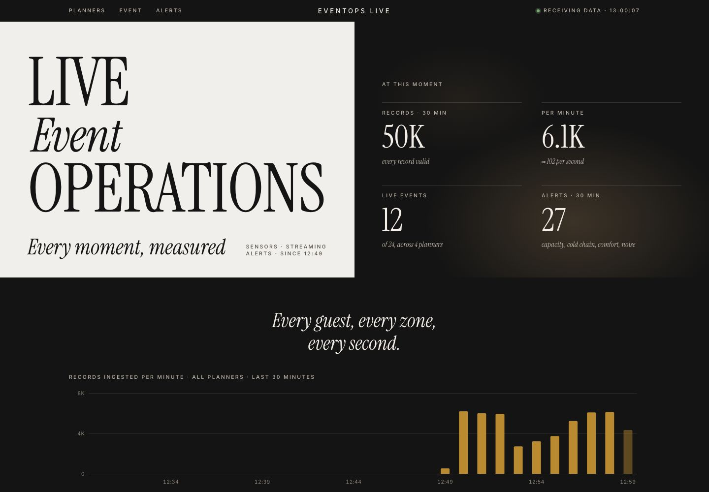
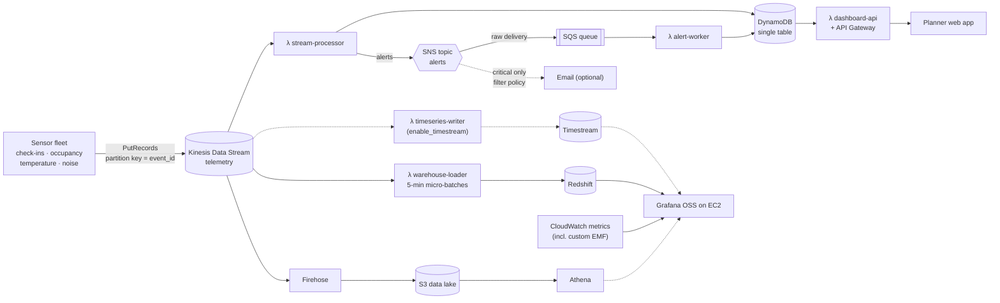
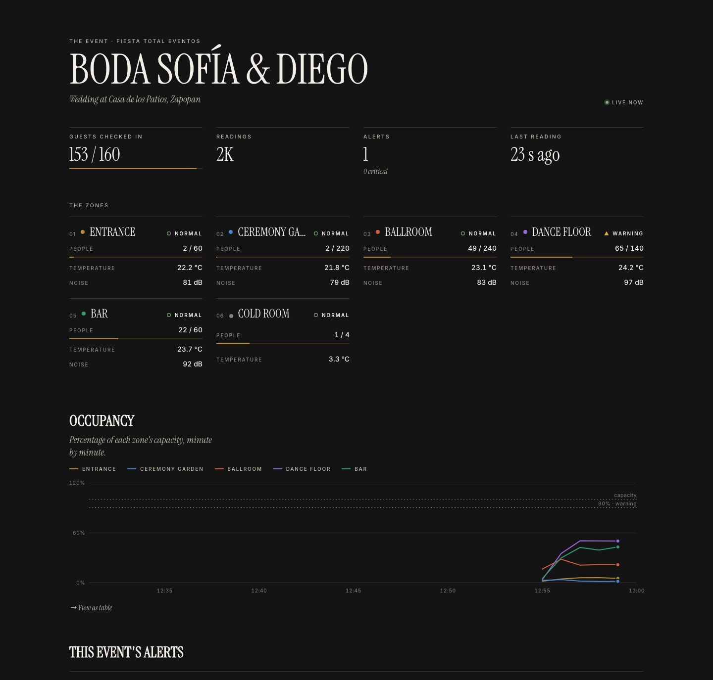
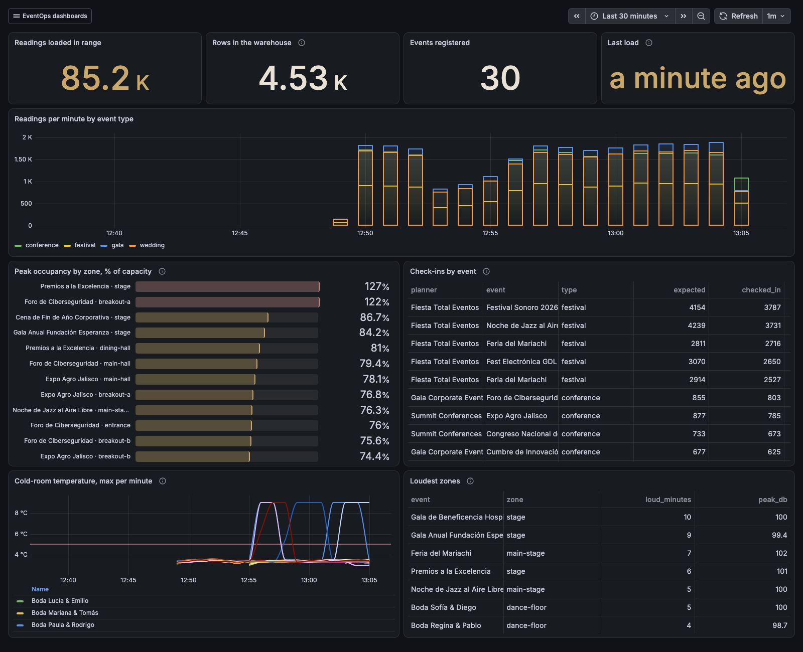
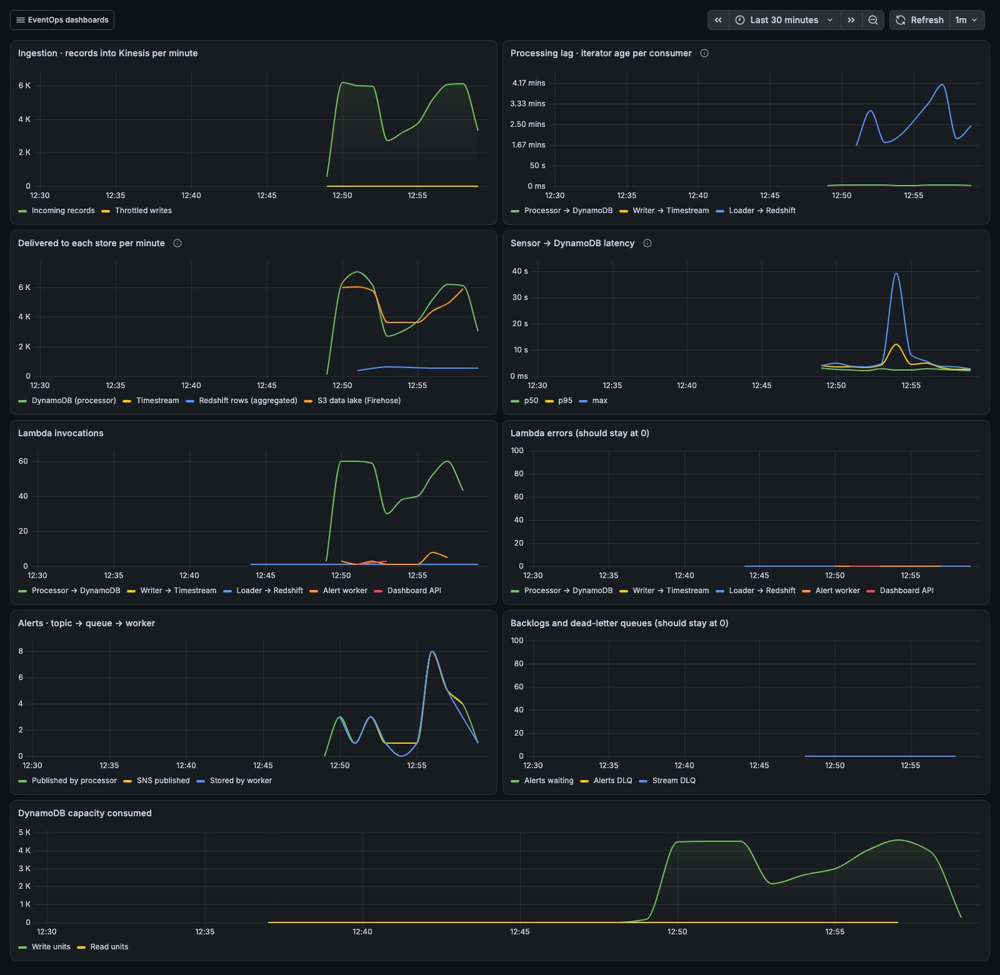

# Live Event Telemetry Pipeline on AWS

Real-time streaming pipeline for **EventOps**, an event-planning SaaS for wedding and event planners. During a live event, sensors at the venue stream guest check-ins, zone occupancy, temperature and noise into **Amazon Kinesis**. Independent **Lambda** consumers turn that one stream into:

- live state in **DynamoDB** (NoSQL), behind a planner-facing web app
- alerts on an **SNS topic**, buffered in **SQS**, stored by a worker
- micro-batches in **Amazon Redshift** (and a time series in **Amazon Timestream** where the account allows it), behind **Grafana**
- a raw **S3 data lake** queried with **Athena**

> *We built a platform that helps event planners manage the operational complexity of large events, and designed the architecture to scale from a few planners managing small events to thousands of planners managing large events simultaneously.*
>
> This lab is the real-time slice of that platform: what happens inside the venue while the event is running.



## Architecture



**One stream, many consumers.** Kinesis keeps every record for 24 hours and lets each consumer read at its own pace, from its own position in each shard. A slow warehouse never delays an alert, and a Timestream outage never stops the live web app. A queue can't do this: each message goes to one consumer.

| Consumer | Batch | Latency | Writes to | Why it is tuned this way |
|---|---|---|---|---|
| `stream-processor` | up to 1,000 records / 2 s | seconds | DynamoDB, SNS | Live state and alerts must be fresh. It pre-aggregates the batch so DynamoDB gets one write per (event, zone, minute), not one per reading. |
| `timeseries-writer` (optional) | up to 500 records / 1 s | ~1 s | Timestream | One point per reading, for the live Grafana charts. Only where the account allows Timestream. |
| `warehouse-loader` | up to 10,000 records / 5 min | minutes | Redshift | A warehouse wants few, large loads. Each load is one idempotent transaction. |
| Firehose | 5 MB / 60 s | ~1 min | S3 (GZIP JSON lines) | Cheapest place to keep everything raw, for SQL with Athena. |

## What each service does

| Service | Role in the pipeline |
|---|---|
| **Kinesis Data Streams** | Ingestion backbone, 2 shards (1,000 records/s each). `event_id` is the partition key, so readings of one event stay in order on one shard. |
| **Lambda** (5 functions, Python 3.13, arm64) | Stream consumers, alert worker and the web app's API. They share one package and one data contract (`src/common.py`). |
| **DynamoDB** | NoSQL live store: current state per zone, per-minute aggregates, alerts, event metadata. On-demand capacity. |
| **SNS topic** | Alert fan-out. Message attributes (`severity`, `alert_type`, `planner_id`) drive subscription filter policies. Per-protocol bodies: readable text for email, JSON for the queue. |
| **SQS** (+ DLQs) | Durable buffer between the topic and the worker. Partial batch failures, a redrive policy after 3 attempts, and a stream DLQ for Kinesis batches that keep failing. |
| **Redshift** | Warehouse: per-minute aggregates and an `events` dimension, for history and comparisons in Grafana. Provisioned `ra3.large` in Academy, Serverless elsewhere. |
| **Timestream** (optional) | Time-series store: every reading, for a live Grafana dashboard. AWS Academy denies it (see below). |
| **Firehose → S3 → Glue → Athena** | Data lake with every raw record, partitioned by hour (partition projection, no crawler). Four saved queries. |
| **API Gateway + Lambda** | Read-only JSON API and the planner-facing web app. |
| **Grafana OSS on EC2** | The required dashboard tool. Data sources and dashboards are provisioned at boot, and AWS access comes from the instance profile, so no keys are stored. |
| **CloudWatch** | Logs, AWS metrics and custom metrics emitted with Embedded Metric Format (`EventOps/Pipeline`). |

## Data contract

Producers send two kinds of JSON records. Every consumer validates them with the same function (`common.decode`). A record that breaks the contract is counted and skipped, never retried.

```jsonc
// kind = event.registered: sent when an event starts and every 60 s after that
{"kind": "event.registered", "event_id": "evt-10131834-wedding-01", "planner_id": "pl-aurora",
 "planner_name": "Aurora Weddings", "event_name": "Boda Ana & Luis", "event_type": "wedding",
 "venue": "Hacienda San Gabriel", "city": "Guadalajara", "guests_expected": 214,
 "zones": [{"zone": "ballroom", "capacity": 240}, ...], "starts_at": "...", "ts": "2026-10-13T18:05:01.120Z"}

// kind = sensor.reading: metric is occupancy | temperature_c | noise_db | checkin
{"kind": "sensor.reading", "reading_id": "4b0c…", "planner_id": "pl-aurora", "event_id": "evt-10131834-wedding-01",
 "zone": "dance-floor", "sensor_id": "occ-dance-floor-01", "metric": "occupancy", "value": 118, "capacity": 140,
 "unit": "people", "ts": "2026-10-13T18:05:02.431Z"}
```

The simulator (`simulator/sensor_fleet.py`) runs 12 events for 4 planners (weddings, conferences, festivals and galas). Each event moves through arrival, main program, party and wind-down, and the simulator injects incidents: a crowd rush, a cold-room door left open, a noise spike or an A/C failure.

## DynamoDB single-table design

| Entity | `pk` | `sk` | `gsi1pk` / `gsi1sk` | Access pattern |
|---|---|---|---|---|
| Planner | `PLANNERS` | `PLANNER#<id>` | | list tenants |
| Event | `EVENT#<id>` | `META` | `PLANNER#<id>` / `EVENT#<id>` | a planner's events (tenant isolation) |
| Zone state | `EVENT#<id>` | `STATE#<zone>` | | live zone tiles |
| Minute aggregate | `EVENT#<id>` | `AGG#<minute>#<zone>` | | 30-minute charts (TTL 7 days) |
| Alert | `EVENT#<id>` | `ALERT#<ts>#<alert_id>` | `ALERTS#<day>` / `<ts>#<id>` | event alerts, platform feed |
| Alert cooldown | `EVENT#<id>` | `COOLDOWN#<zone>#<type>#<severity>` | | deduplication lock (TTL) |
| Platform stats | `STATS` | `MINUTE#<minute>` | | ingestion per minute |

Every screen is served by `Query`/`GetItem` on known keys. There are no scans.

## Alert rules

| Rule | Warning | Critical | Recommended action (added by the worker) |
|---|---|---|---|
| Occupancy / capacity | ≥ 90 % | ≥ 100 % | open the overflow area / stop entry |
| Cold-room temperature (food safety) | | > 5 °C | check door and compressor, notify the caterer |
| Guest comfort | > 28 °C | | turn up the A/C |
| Noise | ≥ 95 dB | ≥ 105 dB | ask the DJ to lower the volume / cut it now |

Every limit is a Terraform variable. The web app colors zones with the same values.

## Reliability, built in on purpose

- **Ordering:** `event_id` is the partition key, so a later batch never carries older readings for the same event. The live state can be overwritten without version checks.
- **At-least-once delivery, handled per store:**
  - Live state writes are idempotent.
  - An alert's id is derived from the reading that triggered it, so the worker's conditional put drops redeliveries.
  - Timestream accepts identical rewrites.
  - The warehouse loader deletes its own `batch_id` before inserting, in the same transaction.
  - The S3 archive key is the shard plus the first sequence number.
  - Only the DynamoDB per-minute counters can over-count after a retry, which is why the exact history comes from the data lake.
- **Poison records:**
  - A failing Kinesis batch is retried, then bisected, then skipped, and its location goes to the stream DLQ, so one bad record can't stall a shard.
  - SQS messages that fail 3 times move to the alerts DLQ.
  - The worker reports partial batch failures, so only the failed messages come back.
- **Alert storms:** a conditional write acts as a per-zone cooldown lock (5 minutes), even across concurrent Lambdas.

## Scaling story

| From a few planners… | …to thousands |
|---|---|
| 2 shards (2,000 records/s) | raise `kinesis_shard_count`. The partition key spreads events across shards. |
| 1 Lambda per shard and consumer | raise `processor_parallelization_factor` (up to 10 per shard, ordering kept per event). Use enhanced fan-out consumers past ~5 readers per shard. |
| DynamoDB on-demand | no capacity planning. The key design keeps each event in its own partition. |
| Redshift `ra3.large` | add nodes, or switch to Serverless (`redshift_mode`), which scales with the query load and costs nothing while idle. |

Try it: `make burst` sends 1,000 readings/s for 2 minutes. The simulator retries only the throttled records, with exponential backoff, and reports them.

## Deploy

Prerequisites: Terraform ≥ 1.11, AWS CLI v2, Python 3.12+, and AWS Academy Learner Lab credentials in `~/.aws/credentials` under the `[academy]` profile.

```bash
make whoami      # which account am I about to deploy to?
make init        # creates/reuses s3://tfstate-<account>-<region> and runs terraform init
make deploy      # ~10 minutes (the Redshift cluster is the slow part); Grafana installs itself ~3 minutes later
make simulate    # 100 readings/s for 5 minutes (RATE=… DURATION=… to change)
make dashboard   # planner web app
make grafana     # prints the URL and admin password; anonymous read-only access is on
```

Optional settings live in `terraform.tfvars` (see `terraform.tfvars.example`), e.g. `alert_email` to get critical alerts by email.

### Moving to a new AWS Academy account

Nothing in the code names an account:

- IAM uses `LabRole` and `LabInstanceProfile`, looked up by name.
- Globally unique names embed the account ID.
- The network is the default VPC.
- The Terraform state bucket is created per account by `make init`.

To switch accounts:

1. Paste the new credentials into `~/.aws/credentials` (`[academy]`).
2. `make whoami`. Check that the account ID changed.
3. `make init`. This creates the new account's state bucket and reconfigures the backend.
4. `make deploy`.

## Dashboards

**Planner web app** (API Gateway → Lambda → DynamoDB): platform totals and ingestion per minute, planners (tenants) and their events, live zone tiles, occupancy over the last 30 minutes, and the alert feed with recommended actions.



**Grafana** (provisioned, in the *EventOps* folder):

| Dashboard | Data source | Shows |
|---|---|---|
| Analytics | Redshift | readings by event type, peak occupancy by zone, check-ins vs. guest list, cold-room maxima, loudest zones |
| Pipeline health | CloudWatch | Kinesis ingestion, iterator age per consumer, delivery to each store, sensor→DynamoDB latency p50/p95, Lambda errors, queues and DLQs |
| Live telemetry (with `enable_timestream`) | Timestream | readings/s, readings per planner, and per event: occupancy, temperature, noise (limits drawn as lines), check-ins, latest reading per zone |





Athena is provisioned as a Grafana data source too, for ad-hoc SQL on the raw data lake (Explore). Its saved queries are in the Athena console under the `eventops` workgroup.

## AWS Academy notes

Deployed and verified in an AWS Academy Learner Lab account on 2026-10-13. The defaults are what works there:

| Constraint (verified) | How this repo handles it |
|---|---|
| No IAM role creation | every function, Firehose and EC2 use `LabRole` / `LabInstanceProfile` (Firehose can assume `LabRole`) |
| A service control policy denies `kinesis:IncreaseStreamRetentionPeriod` and `s3:GetBucketObjectLockConfiguration`. The Terraform AWS provider calls both on every stream and every bucket. | `academy_compat = true` (default) creates the stream and the data lake bucket with the AWS CLI (`scripts/academy/`), from Terraform, idempotently; destroy deletes them. In a regular account, set it to `false` to use `aws_kinesis_stream` / `aws_s3_bucket`. |
| The lab policy denies every `timestream:*` action (and explicitly denies Timestream for InfluxDB). AWS also closed LiveAnalytics to new customers on 2025-06-20. | `enable_timestream = false` by default; the writer, table and live dashboard are ready for an account that has access |
| Redshift Serverless is denied; DC2 nodes are retired | `redshift_mode = "provisioned"` (default) runs a single `ra3.large`; the Data API works with temporary credentials |
| Amazon Managed Grafana needs IAM Identity Center | Grafana OSS on a `t3.small`, with an Elastic IP and port 3000 open only to your IP |

## Test without an AWS account

```bash
make test        # Python tests on mocked AWS (moto) + `terraform test` with mocked providers
make local-demo  # the whole pipeline on your laptop, web app on http://localhost:8080
```

- The Python tests run simulator records through every consumer:
  - DynamoDB, SNS → SQS, the worker and the API
  - the Timestream writer
  - the SQL the Redshift loader generates
  - the invalid-record, cooldown and idempotency paths
- `terraform test` plans the stack in every mode and checks the switches:
  - Academy defaults
  - optional stores off
  - archive written by the Lambda
  - a regular account with every store, including Timestream and Serverless

## Cost and cleanup

Approximate us-east-1 prices. Check the AWS pricing pages before relying on them.

| Resource | Cost while deployed |
|---|---|
| Kinesis, 2 shards | ~$0.03/hour |
| Grafana EC2 `t3.small` + Elastic IP | ~$0.03/hour |
| Redshift provisioned `ra3.large` (default) | ~$0.54/hour, **always, even when idle** |
| Redshift Serverless, 8 RPU (outside Academy) | ~$3/hour only while queries run (60 s minimum each); up to ~$1.20/hour while 5-minute loads flow |
| Lambda, DynamoDB, SNS, SQS, Timestream, Firehose, S3, Athena | cents at lab volumes |

Learner Lab stops EC2 instances when the session ends, but **not** Kinesis or Redshift. When you finish, run `make destroy`. Between sessions, at least run `terraform apply -var redshift_mode=off` (about $13/day saved).

## Repository layout

```
├── *.tf                      infrastructure (one file per concern)
├── src/                      Lambda code: processor, alert worker, timeseries writer,
│   ├── common.py             warehouse loader, dashboard API; shared contract + key layout
│   └── static/index.html     planner web app
├── simulator/sensor_fleet.py Kinesis producer (sensor fleet)
├── grafana/                  dashboards (JSON) + their generator
├── scripts/                  per-account state bootstrap, local demo
└── tests/                    moto pipeline tests, terraform test
```
